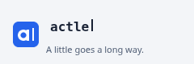
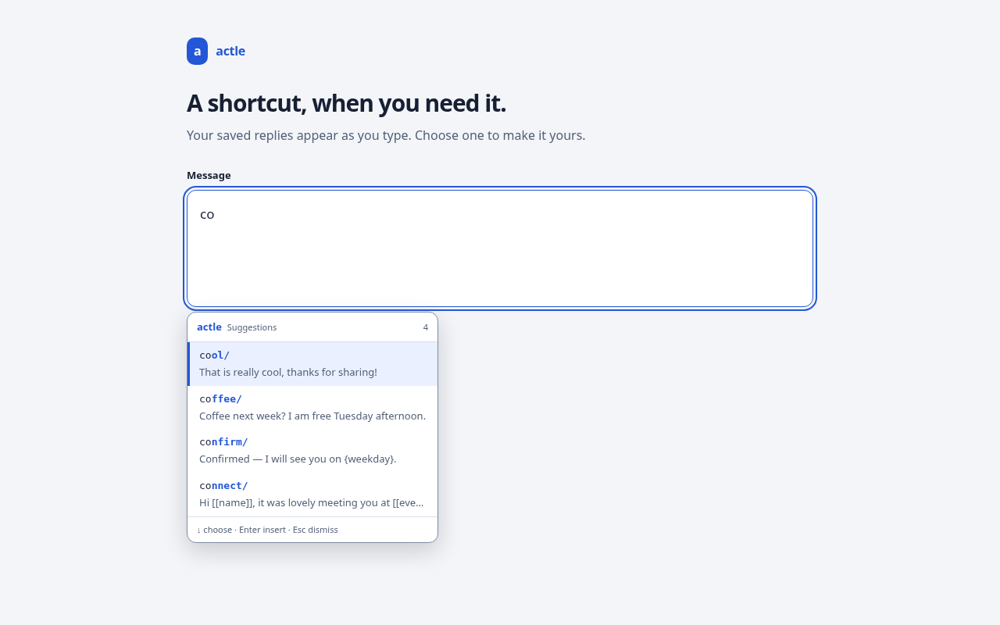

# actle – Chrome and Firefox extension

Expands shorthands such as `cool/` into full text in supported webpage text
fields, textareas, and rich-text editors (contenteditable), as you type.
Password inputs and other credential or payment fields identified by page
metadata are excluded. Browser-protected pages and some custom editors do not
allow expansion.



The preview loops here; the extension plays the logo once and lets you replay it.

## Install in Chrome (unpacked)

1. Open `chrome://extensions` and turn on **Developer mode**.
2. Click **Load unpacked** and choose this `chrome-extension` folder.
3. The options page opens automatically; add your shorthands there.

Type a trigger in the **Try it** box on the options page to see it work.
Press Backspace right after an expansion to get the trigger back.

A trigger fires only when you typed it (or pasted it). A page can read whatever
lands in its own fields, so text a page's script writes into a field, input
events it dispatches and keys it fakes in the search overlay never produce an
expansion; otherwise any site could try `addr/` and read your address back.
Correcting a typo with Backspace keeps the rest of the word trusted, and a
trigger typed at the start of a new line in a rich editor expands too.

On a fresh install the three examples (`cool/`, `sig/`, `td/`) are added only
while the library is still empty, and never replace anything. On Chrome a
library synced from another device can still arrive after them; delete the
examples you do not want.

After actle is updated, reloaded, turned off or removed, Chrome keeps the old
copy running in pages that were already open, cut off from your current
library and settings. Those pages stop expanding: the first time you type a
saved trigger there, a note asks you to reload the page.

## Toolbar command palette

Open the extension from the browser's toolbar to get a compact searchable view of
your shorthand library. Search matches triggers first and then expansion text;
press Enter to copy the top result, or use the arrow keys to move through the
results. A template opens its fill-in form first; **Copy text** copies the
completed script with its date/time/weekday placeholders rendered and its
`{cursor}` marker removed. A script using only `{weekday}` and automatic
placeholders copies the rendered text directly. Ordinary snippets without
named blanks or the new variables still copy their saved text, including
built-in placeholders. The same popup also shows whether expansion is
active globally and on the current site, with quick toggles for both.

This makes the toolbar useful even when you only half remember a trigger, and
lets you grab an expansion for places where automatic insertion is not wanted.

## Save selected text

Select text on any page, right-click, and choose **Save selection as actle
shorthand**. The library opens with the selection as a draft expansion; give
it a trigger and save. Nothing is added to your library until you save, and
the one-time draft is kept only in local storage until the library shows it.

## Deleting and Recently deleted

**Delete** on a library row removes the shorthand and says so under the list,
with an **Undo** button that puts it back under its original id and place in
the list. The offer stays until your next library action or a reload.

Each deleted shorthand is also copied to **Recently deleted**, a collapsed
section below the list. The copies stay in this browser's local storage on
this device, in Chrome and Firefox alike: they are never synced, exported, or
sent anywhere, and do not count toward Chrome's sync quota. Only the 50 most
recent are kept; deleting another drops the oldest. **Restore** puts one back,
**Delete for good** removes one copy, and **Empty Recently deleted** (after a
confirmation) removes them all. Restore is refused, and the copy kept, while
another shorthand uses the same trigger or when the shorthand would no longer
fit in Chrome's sync storage. If sync has already brought the shorthand back
with the same text, Restore only removes the copy. If it came back with other
text, the copy is never dropped for it: Restore adds the copy as a separate
shorthand once its trigger is free, and deleting the one that came back keeps
both copies. If the copy cannot be saved, the page asks before deleting the
shorthand without one.

In Chrome, the deletion itself still syncs to your other devices; only the
device where you deleted it has the copy.

## Search overlay

Typing `;;` in a supported field opens a search overlay listing every shorthand: type
to filter, arrow keys to choose, Enter to insert, Esc to cancel. It is there
for the snippets you cannot remember the trigger for.

While you search, focus stays in the page's own field. The search overlay never
calls `focus()`, and instead intercepts keys at the document level, so searching
does not disturb sites that close menus or save drafts on blur. Selecting a
template moves focus to its fill-in form until you insert or cancel. Both
overlays render in closed shadow roots to isolate their styles from the page.

Change or disable the trigger on the options page.

Chrome stores your library and settings in extension sync storage, so they can
follow your Chrome profile when its sync settings permit it. Firefox stores
them locally in your browser profile and does not automatically sync them.
Use JSON export and import to move your library between browsers or devices.
When sync merges two devices' libraries into two shorthands with the same
trigger, the library marks both rows: typing the trigger expands only one of
them (the one used most in this browser, or the first in the list when they
are tied), so rename or delete the other.
Use **Export JSON** / **Import JSON** on the options page to move it to the
Windows and Android apps (same file format, see `../shared/SPEC.md`). Imports
are previewed before applying: the manager shows how many triggers are new,
updated, or unchanged, and **Merge safely** preserves local-only shorthands.
A full replacement is still available when that is what you intend.

## Suggested shortcuts

Suggestions are on by default. Type at least two characters of a saved trigger
at the start of a field or after a space or punctuation, such as `th` for
`thanks/`. A combined emoji or a letter with combining marks counts as one
character. Up to five matching partial triggers appear beside the field, with
their saved text previews. Matching is case-sensitive; the snippets you use
most appear first, with shorter completions and then library order breaking
ties. Use counts stay in this browser profile's local storage and are never
synced, exported, or sent anywhere. The same most-used ordering applies to
the `;;` search overlay and breaks ties in the toolbar palette; successful
insertions and toolbar copies count as uses.

Press ↑ or ↓ to select a result, then Enter to insert it, or click a result.
Focus stays in the page's field while browsing suggestions. Enter before you
select a result keeps its normal behavior; Tab always keeps its normal behavior.
Escape hides suggestions for the current shortcut while you keep typing it.

### Finish saved paragraphs

The same list also offers to finish a saved snippet you start typing in full.
When the words before the caret match the opening of a snippet that has at
least six words, ignoring case and runs of spaces, the snippet appears; choose
it to replace the words you typed with the whole snippet. The first letter keeps
the case you typed, so a lowercase start mid-sentence stays lowercase.
Backspace right after puts your words back. Only the fixed opening counts: the
text before a snippet's first `[[blank]]` or `{variable}`. A trigger prefix
takes priority when both match, and the words must have been typed in one go.

Settings → **Finish saved paragraphs** chooses how many words are needed, from 2
to 6 (3 by default), or Off. It works while suggestions are on.
Fully typed triggers still expand immediately, including after suggestions are
dismissed. Backspace immediately after accepting a suggestion restores the
partial trigger you actually typed.

Choosing a template opens the same fill-in form as its complete trigger.
Cancel leaves the typed prefix in place. Suggestions use your selected text
animation and respect global pause, site exclusions and protected fields.
Turn off **Settings → Suggest saved shortcuts** to hide them while keeping
complete-trigger expansion and the `;;` search overlay available. The setting
saves immediately; a failed save restores the previous choice and shows an error.

Suggestions only match snippets already in your library. The extension does
not learn new snippets from typing history, save the text you are composing,
or send it to a prediction service.



## Protected fields

Expansion, suggestions and the `;;` picker skip password inputs and fields
marked with credential or payment `autocomplete` values: `username`,
`current-password`, `new-password`, `one-time-code` and `cc-*`. English username or
password field names and labels are also recognized, along with email/login
inputs in identifiable sign-in or registration forms. Ordinary contact and
message fields remain eligible.

These checks use field metadata, not entered text. A page that does not identify
its fields may not be recognized. You can pause actle on that site from the
toolbar or add its hostname under **Never expand on these sites**.

## Google Docs and Slides (experimental)

Docs and Slides draw text themselves and take typing through a hidden frame, so
ordinary field handling never sees it. In those two editors, actle remembers the
characters you physically type until the caret moves another way (a click, an
arrow key, Enter, Tab or a shortcut). When they end in a trigger, it removes the
trigger with simulated Backspaces and pastes the expansion; `{cursor}` moves the
caret back with simulated arrow keys. Fill-in templates open the usual form.

This depends on how Google's editors handle simulated keys and paste, which can
change without notice, and it has been tested only against a stand-in page.
Limits: undo with the editor's own Ctrl+Z (Backspace does not restore the
trigger), and the `;;` picker and suggestions do not appear there. A trigger
typed right after clicking into the middle of a word can expand, because the
characters before the click are unknown. Add `docs.google.com` under **Never
expand on these sites** to turn it off. Sheets, Forms and Drive's own fields
use the normal handling.

## Plans and support

This release is an **unlimited free preview**. The library's **Plans & support**
section and toolbar show today's local usage. Purchasing and license activation
are not configured yet; no price or payment provider has been selected.

The prepared free plan allows **100 auto completes per browser profile per
day**, resetting at local midnight. Complete triggers, accepted suggestions,
picker selections, and confirmed templates each count as one successful
insertion, including the library playground. Opening or cancelling a template
does not count. Undo remains available and does not refund the original use.
Your library, editing, import/export, and toolbar copying remain free at the
limit. A denied insertion leaves the trigger in place; a denied template keeps
its answers for you to edit or cancel.

The future **Forever** license is a small, one-time way to support actle, with
unlimited auto completes, no recurring charge, and no expiry in the license.
Activation verifies a signed key locally, without an account or activation
server. Keep that key to reactivate it in your own browser installations.
Removing it from one browser returns that installation to its free allowance;
it does not cancel or refund a purchase. Usage and activation do not sync or
appear in snippet exports.

The daily allowance is local to each browser profile and uses the device's
clock. It is a courtesy limit, not an account-wide or tamper-proof quota. When
enabled, concurrent tabs share it. An interrupted insertion after an allowance
is reserved can retain one use until midnight even if no text was inserted.
The cap stays off unless release configuration explicitly enables it and
provides both a usable public verification key and an HTTPS checkout.

Publisher setup, manual fulfillment, and remaining launch work are documented
in [PREMIUM.md](store/PREMIUM.md). This plan applies to the browser extensions;
the companion Windows and Android apps are unchanged.

## For site authors

Add `data-shorthand-ignore` to any element to stop expansion, suggestions and
the search picker inside it (the attribute also applies to all descendants).
Use the appropriate `autocomplete` tokens on credential and payment controls.

## Files

| File                  | Purpose                                                        |
| --------------------- | -------------------------------------------------------------- |
| `manifest.json`       | Manifest V3 definition                                         |
| `src/expander.js`     | Pure matching/placeholder logic (shared with the tests)        |
| `src/template.js`     | Named-blank parsing and literal-answer substitution             |
| `src/template-form.js` | Temporary fill-in form and live preview                       |
| `src/storage.js`      | Chrome sync / Firefox local storage (one key per shorthand)    |
| `src/content.js`      | Watches editable fields and performs the replacement           |
| `src/suggestions.js`  | Saved-trigger prefix matching and the in-field suggestion list |
| `src/google-docs.js`  | Experimental Google Docs and Slides typing bridge              |
| `src/field-safety.js` | Identifies credential and payment fields from page metadata    |
| `src/animation-frames.js` | Grapheme-aware Expand and Casino animation frames             |
| `src/expansion-feedback.js` | Temporary in-field animation, respecting reduced motion    |
| `src/picker.js`       | The `;;` search overlay (closed shadow root, key capture)       |
| `src/palette.js`      | Pure ranking logic for the toolbar command palette             |
| `src/import-plan.js`  | Pure import preview and safe-merge planning                    |
| `src/background.js`   | Background initialization: seeds examples, updates the badge  |
| `src/premium-config.js` | Release-only allowance, public verification key, and checkout settings |
| `src/license.js`      | Offline verification of signed Forever licenses                |
| `src/premium-service.js` | Background-owned local usage and license storage             |
| `src/premium-client.js` | Insertion allowance, accounting, and limit notices            |
| `src/premium-ui.js`   | Plan, usage, and license controls in the library and toolbar     |
| `src/options.*`       | Library manager, previewed imports, export, excluded sites     |
| `src/popup.*`         | Toolbar search/copy palette plus global and per-site controls  |
| `test/`               | Unit tests (`npm test` in `chrome-extension/`)                 |
| `scripts/build.js`    | Browser-specific manifests and reproducible release ZIPs      |
| `scripts/issue-license.js` | Publisher's offline license issuer; excluded from packages |

## Build release packages

With Node.js 22.2 or later, run from this directory:

```sh
npm run build
```

This uses Node's built-in modules and needs no dependency installation. It
creates unpacked browser directories at `dist/chrome/` and `dist/firefox/`,
plus `dist/actle-chrome-1.0.0.zip` and
`dist/actle-firefox-1.0.0.zip` for the current manifest version.
Each ZIP places its browser-specific `manifest.json` at the root and includes
only runtime scripts, styles, HTML, and icons. Tests, development dependencies,
and store documentation are not bundled. Rebuild after changing runtime files.
Keep the Firefox extension ID in `scripts/build.js` stable across releases so
Firefox can associate updates and saved data with the same extension.

## Store submission

[store/LISTING.md](store/LISTING.md) contains listing copy, permission
justifications, screenshot specifications, and a reviewer walkthrough. The
completed [privacy policy](store/PRIVACY.md) has a public URL recorded in the
listing. Registered store accounts and final dashboard declarations are required
to publish.

The [store images](store/LISTING.md#screenshots-and-artwork) include light/dark
captures of the running Chrome and Firefox libraries, fill-in forms, the
in-field picker, and a small promotional tile. To refresh them after rebuilding,
run
`node scripts/store-assets.js` and `node scripts/store-assets-firefox.js` with
the browser environment described below. These use disposable browser profiles
and fictional snippets; they do not modify your library.

## Development and validation

Install the pinned development tools and dedicated test browsers:

```sh
npm ci
npx playwright install --no-shell chromium firefox
# Linux x86_64: install the pinned Firefox driver, verifying its archive checksum.
bash scripts/install-geckodriver.sh /tmp/shorthand-geckodriver
export GECKODRIVER_PATH=/tmp/shorthand-geckodriver/geckodriver
```

Then run:

```sh
npm run check             # JavaScript syntax
npm test                  # matching, templates, placeholders, storage, imports and packaging
npm run build             # generate both browser packages
npm run lint:firefox      # validate the generated Firefox extension with web-ext
npm run test:e2e          # Chromium extension behavior
npm run test:e2e:firefox   # Firefox extension behavior
```

The end-to-end suite in `e2e/` loads the unpacked extension into Chromium and
types into a fixture page, covering what unit tests cannot: text insertion,
caret placement, the undo window, and the overlay swallowing keystrokes without
taking focus while searching, plus filling and inserting templates. The separate
`e2e-firefox/` suite exercises the generated Firefox package. Install browser OS
dependencies if Playwright reports them missing; on a supported Linux development
machine, use `npx playwright install-deps`.
On other platforms, install geckodriver 0.37.1 and set `GECKODRIVER_PATH` to
its executable. `FIREFOX_PATH` can override the dedicated Firefox executable.
The driver uses `--allow-system-access` only in its disposable test profile to
exercise extension pages. If a nested cloud sandbox prevents Firefox startup,
scope `MOZ_DISABLE_CONTENT_SANDBOX=1` to `npm run test:e2e:firefox` in that
environment; ordinary development and CI keep the browser sandbox enabled.
Managed browser policies can prevent loading unpacked extensions, so use the
dedicated test browsers instead of a policy-restricted system browser.

Set `EXTENSION_PATH=dist/chrome` when running the Chrome suite to exercise the
exact staged release package. `npm run build` must run first for both browsers.

Passing these checks does not sign a Firefox release or submit either store
listing. Before upload, test each generated package with the reviewer walkthrough
in [store/LISTING.md](store/LISTING.md).
